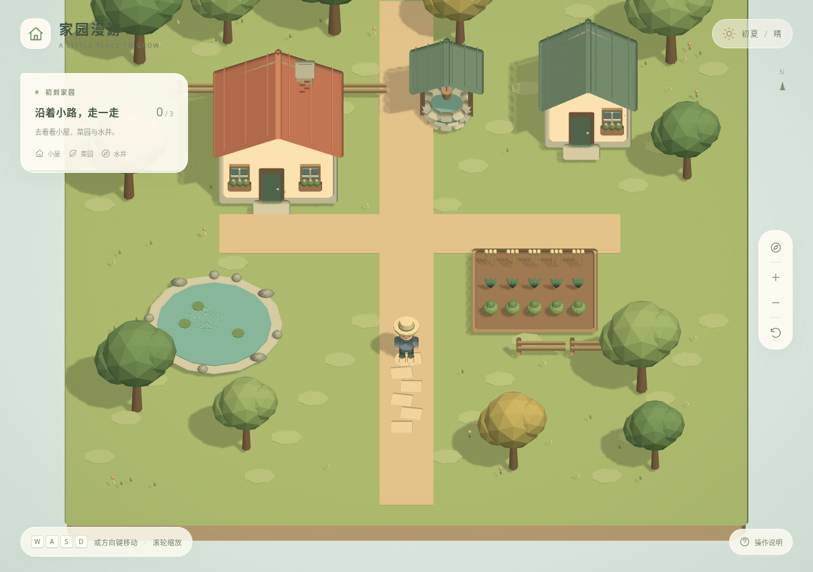

# 家园漫游 · 前端 Demo

Babylon.js + TypeScript + Vite 的轻量 3D 前端起点。通过一座程序化小院验证引擎接入、模型风格、角色骨骼动画、桌面与触摸操作。

当前为独立运行的技术 Demo，角色直接操控和地标探索用于验证基础交互，不代表正式经营玩法已经定稿。



[手机竖屏截图](docs/screenshots/mobile.png)

## 本地运行

需要 Node.js 24（版本见 `.nvmrc`）及 npm。

```sh
npm ci
npm run dev
```

开发服务默认监听 `0.0.0.0:5173`。同一局域网内的手机可使用开发机局域网 IP 和该端口访问。仅需要本机访问时，运行 `npm run dev -- --host 127.0.0.1`。

```sh
npm run build
npm run preview
```

生产输出位于 `dist/`，可以托管在支持静态文件的站点。资源使用相对路径，支持部署在子目录。运行时无需后端、账号、环境变量或外部素材 CDN。

## 操作

| 功能 | 电脑 | 手机 |
| --- | --- | --- |
| 人物移动 | WASD / 方向键；也可按住画面拖动 | 按住画面后滑动，虚拟摇杆控制方向 |
| 停止 | 松开按键或鼠标 | 松开手指 |
| 镜头缩放 | 滚轮、右侧加减按钮 | 双指捏合、右侧加减按钮 |
| 查看地标 | 靠近后按 E 或点击提示 | 靠近后点击提示 |
| 全景 / 跟随人物 | 右侧罗盘按钮 | 右侧罗盘按钮 |
| 回到起点 | 右侧回转箭头 | 右侧回转箭头 |
| 操作帮助 | 右下角问号 | 右下角问号 |

镜头保持正面斜俯视，不采用对角线等距视角。人物在地图上连续移动，建筑、水域、树干、围栏和地图边缘具有碰撞约束。失焦、触摸取消或失去指针捕获时会清除移动输入；双指缩放不会同时控制人物。

## 场景与模型

- 一块带 624 个逻辑土地单元的有限地图，包含草地、小路、菜园、水面与建筑占用信息。网格不限制人物移动。
- 小屋、工具棚、水井、菜园、树木、池塘与围栏均由代码生成，使用统一的奶油色、陶土色和灰绿色系、哑光材质与柔和低多边形造型。
- 人物具有实际 Babylon.js Skeleton 和蒙皮顶点权重，包含髋部、躯干、头部、双臂与双腿共 7 根骨骼。站立和步行动作共享同一套骨架，摆臂、迈步与移动速度同步。
- 静态场景按材质合并网格、冻结变换，限制渲染像素比最高为 1.5；使用 1024 像素阴影贴图。模型与素材无外部下载依赖。
- 走近并查看小屋、菜园、水井可完成三个地标的探索。此进度只保留在当前页面会话中。

## 代码组织

```text
src/
  main.ts                 入口、异步引擎加载、热更新清理
  ui.ts                   页面 HUD、地标详情、操作说明
  style.css               竖屏与桌面响应式界面
  game/
    game.ts               引擎生命周期、镜头、光照与帧更新
    input.ts              键盘、Pointer Events、双指缩放
    movement.ts           独立于渲染的移动与碰撞逻辑
    world-data.ts         地图布局、碰撞体、地标、土地数据
    models.ts             程序化基础造型与材质配色
    world.ts              场景组合与静态几何合并
    character.ts          蒙皮人物与骨骼动作
tests/
  movement.test.ts         移动、碰撞与地图数据检查
  e2e/                    桌面及移动端浏览器功能验证
```

土地数据、输入、移动逻辑与模型生成保持分离，方便后续逐步引入经营系统。当前没有添加后端通信、生产计时、存档、战斗或复杂物理依赖。

## 验证

```sh
npm run typecheck
npm test
npx playwright install chromium
npm run test:e2e
```

浏览器测试会先构建生产代码，再启动端口 4173 上的预览服务。使用真实 Chromium WebGL 渲染，并通过浏览器触摸协议验证拖动、取消与双指缩放。测试包含截图、碰撞、地标交互、键盘释放和失焦、镜头控制、弹窗暂停以及横竖屏布局。

环境已经安装 Chromium 时，可以复用现有浏览器：

```sh
PLAYWRIGHT_CHROMIUM_EXECUTABLE_PATH=/usr/bin/chromium npm run test:e2e
```

仅开发模式和显式设置 `VITE_E2E=true` 的测试构建提供只读的 `window.__DEMO__.snapshot()` 状态，供自动化验证使用。正常 `npm run build` 不暴露此接口。

引擎以独立文件加载，当前生产引擎包约 420 KB gzip；首次进入有加载状态和 WebGL 不可用提示。自动化测试使用软件 WebGL，功能通过不等于低端手机的帧率验证；发布前还需要 Android / iOS 真机和移动 Safari 检查。

## 开发边界

本仓库保存前端代码、Demo 素材与运行说明。正式游戏方案在设计仓库中维护。后续经营规则、角色操控方式、地图生成、工人和战斗系统需依据确认后的设计逐步实现。
