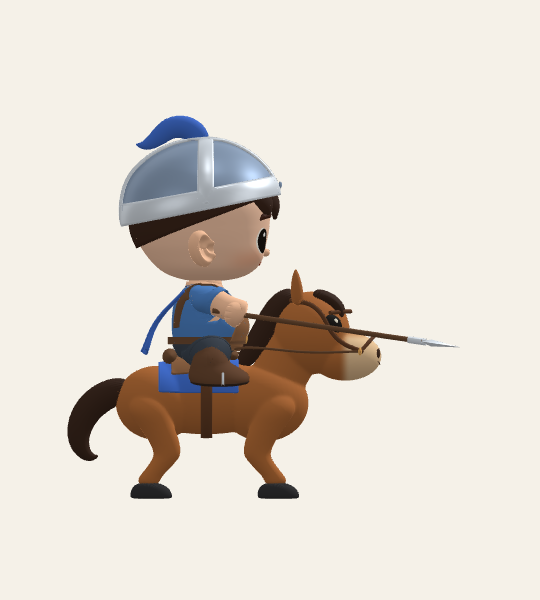
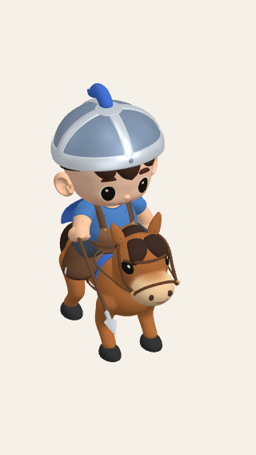
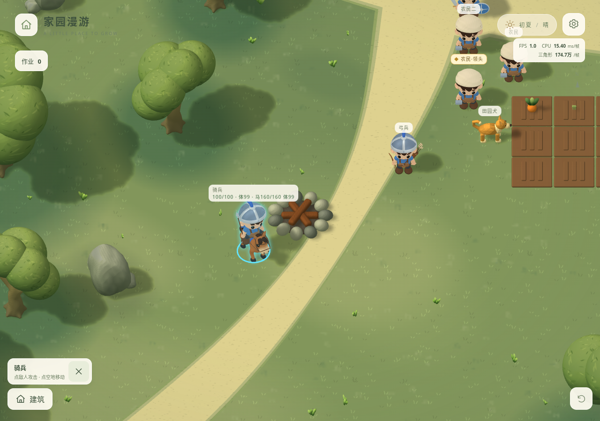
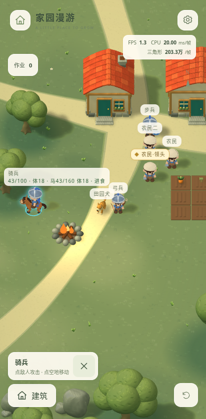

# 战斗提速、骑兵与自动进食

后续碰撞更新：骑兵物理半径现为 0.6；原 1.12 仅保留战斗接触用途，见[移动连续性批次](../movement-continuity/implementation.md)。下文保留本次历史交付记录。

2026-11-01，按本轮“开始一起改吧”授权完成。基于远端最新 main 继续开发，不回退历史交接提交。

## 当前行为

- 步兵、弓兵及敌军的攻击间隔、准备和收招均除以 3.5。单击伤害沿用试行值；连续点击不能重置冷却，近战和投射物仍只结算一次。满体力、使用 50 ms 模拟步进实测，步兵每 0.4 秒、弓兵每 0.5 秒、敌方近战每 0.5 秒、敌方弓手每 0.6 秒发动一次，分别为旧版 3.25、3.30、3.20、3.33 倍频率。详见 [实测记录](evidence/cadence.json)。
- 骑兵以马上长枪近战参战，支持单独点选、指定攻击、受击反击、点地离开战斗、受伤和自动进食。试行生命 100、攻击 26、护甲 3、射程 2.4、移速约 6.96，骑乘碰撞半径 1.12；近战攻击距离计入目标体积，步兵不会为了打骑兵挤入马身。马仍单独保存体力、生命和餐份；战斗伤害结算在骑手身上。
- 据点圆圈、旗杆和旗帜已移除。敌人警戒、追击上限、据点清理与实际搬运奖励继续有效；不增加常驻战斗按钮。
- 删除选中单位“进食”和火堆“在此进食”两个入口。已开启供餐火堆 30 格内，体力低于 30% 或生命未满时自动休整。当前生产搬运、手动移动和战斗优先，缺料由人类单位实际从仓库配送，动物只进食。受伤但体力充足也能自动恢复，关闭的火堆不会被自动点燃。
- 火堆放置仍预留 2×2 格，施工中仍占满施工区域；建成后按真实石圈使用半径 1.34 的圆形障碍。实测网格外沿约 1.33，寻路与避让另加单位自身半径。空角可走，其他建筑不能侵占预留格子；点击采用实际网格，高亮不再铺方形底色。
- 存档升级到 v8，保存骑兵战斗状态、剩余冷却/攻击/投射物、生命体力、自动休整和途中补给。按本任务无需兼容旧档的范围，不迁移 v7；旧档不能继续，开始新游戏仍须明确确认覆盖。

## 动作与资源

共享人体的 `combat-actions.json` 新增 `LanceThrust`，以 `RideIdle` 为基准，固定根、下肢和坐姿，通过手臂 IK 生成 31 个相位样本。与挥剑、射箭一起维护在同一 GLB 和 `characters.blend`，共享人类动作共 11 套；原有人体、装备、马模型、骨长及移动作业轨道不变。

马保持独立骨架，使用原有站姿生成 Babylon 原生常量轨道，并与骑手攻击组一起按游戏时钟采样。没有新增运行时 IK、粒子或阴影光源，伤害不依赖动画事件；单位数、寻路限频和火堆最多两盏局部灯的预算不变。

正式共享资源在 Babylon 9.32.1 中检查正面、侧面、游戏视角、手机缩小及连续周期。三兵种各视角均实际播放至少两个原生完整周期，共 72 个骨架相位样本，见 [周期记录](evidence/cycles.json) 和 [骑兵连续录像](evidence/cavalry-cycles.webm)。骑手保持坐姿、长枪从马身侧面刺出，手部握持与装备随动可见；这次检查不改变其他存量造型的原型审查结论。

补充完整取景的[步兵正面](evidence/infantry-front-0.48.png)、[步兵手机](evidence/infantry-mobile-0.48.png)、[弓兵正面](evidence/archer-front-0.48.png)和[弓兵手机](evidence/archer-mobile-0.48.png)。

## 验证记录

- 类型检查和 Vite 生产构建通过。148 项逻辑测试通过，覆盖三倍攻频、反击与手动移动优先、多人接近与马匹体积、近远程唯一结算、保存恢复、圆形障碍与网格占地、自动恢复/补给及暂停。
- `python tools/verify_character_library.py` 通过：180 个远景部件、600 项几何/材质/蒙皮对照、993 条原有动作轨道及两套骨架绑定保持一致。
- 10 项相关桌面/模拟手机浏览器场景最终均通过：单兵连续点地与读档继续、骑兵与弓兵分别下令/攻击/撤离、火堆空角通行及绕行、清理奖励只生成一次、重伤且体力充足时自动运粮与恢复、狗/骑手/马独立进食、骑兵自行补给及途中读档、暂停冻结、领头发言清除、名称避让和窄/矮屏设置居中。最后受影响的 6 项复测分两次完成（5 项通过，桌面完整供餐单独复测 1 项通过）。

浏览器初次检查中，软件 GPU（尤其并行动作审查时）的游戏时间推进较慢，建造/运输用例原 60 秒墙钟等待提前超时；状态记录确认施工和重伤士兵取粮返程仍在推进。调整等待时间，并在动作审查结束后复测，未加快游戏时钟。另一用例把马身后方当空地点击，实际选中了骑兵；修正为无遮挡位置，继续通过真实指针验证。

## 当前限制

数值仍为试行配置；骑兵本轮是普通马上近战，没有冲锋、践踏或马匹独立受击系统。进食沿用待机姿态，没有新增进食骨骼动作。浏览器检查使用云端 Chromium/SwiftShader 与模拟手机视口，不能代表真实 iPhone 性能；本轮未进行真机测试。

设计入口：[战斗系统](https://github.com/goodleap/world-design/blob/main/玩法设计/战斗系统/README.md)、[体力与进食](https://github.com/goodleap/world-design/blob/main/玩法设计/基础经营/体力与进食.md)、[火堆设施](https://github.com/goodleap/world-design/blob/main/玩法设计/基础经营/火堆与体力.md)。
