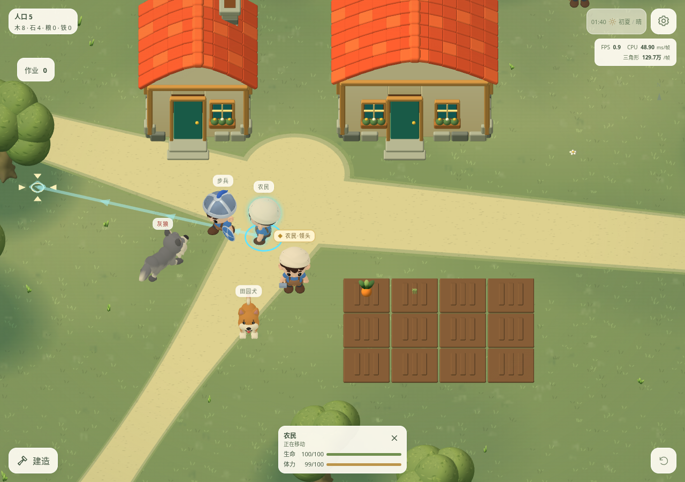
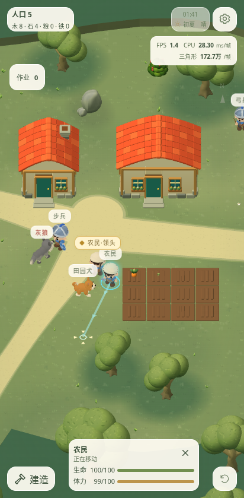
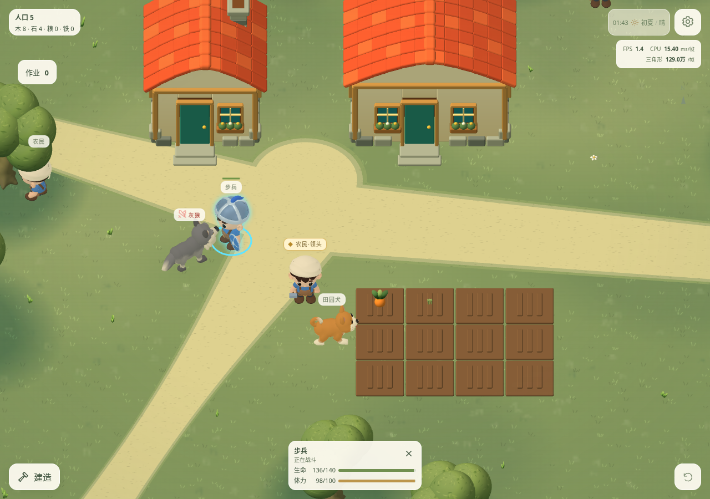
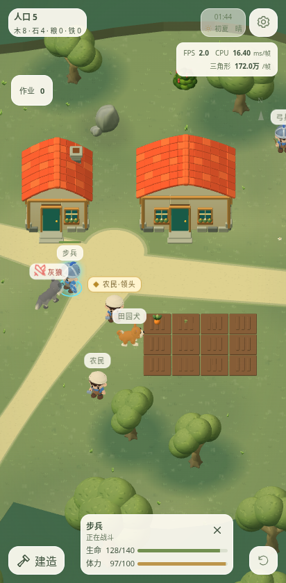

# 统一战斗、路径与攻击反馈（2026-11-02）

本轮三批中的第一批。此前我方只会受击反击，敌人主要只识别士兵；现在敌我共用目标规则，在警戒范围主动开战。所有人物和狗都可受击，优先作战单位，同类最近；有效作战目标保持稳定，明确指定目标与手动移动保持优先。

- 士兵警戒 8、追击 14 世界单位；敌军另受营地边界（至少 14，新增哨兵 16、巡逻 18）约束。我方自动追击锚定交战起点，超界沿路返回。灰狼警戒 11、追击 17，固定狼锚定出生地，袭击狼锚定本次交战起点。
- 农民、领头和狗死亡中断作业、落下在途物资、清理进食／移动／选择；生命为零后不能恢复。领头死亡关闭其指挥及发言。人类退出存活人口，狗不计人口。死亡游戏时间保存，尸体沿用统一退场过程，方向在第二批调整。
- 增加三组双人哨兵和三组双狼；全部实际出生点通过地形和开局距离检查。固定狼与原来的随机袭击独立保存，死亡只结算一次，不随下一波重置。
- 当前选中单位有目的地时显示浅青色路线带、稀疏箭头和终点菱形，直接读取当前剩余避障路线，包括赴工、搬运、赴餐和追击。闲逛不显示；作业成功仍取消选中。仅一个动态网格，无额外灯光或渲染通道。
- 攻击命令接受后，目标名称旁红色 SVG 交叉剑闪现约 0.7 游戏秒，再保持小标记；换目标、移动、死亡、取消选择时更新／隐藏。自动交战也显示当前选中士兵的目标。不增加敌人地面圈。
- 存档 v11，按用户指令不兼容旧存档；入口提示不可继续。当前版本内生命、死亡、目标、箭、冷却、任务与奖励完整保存。

验证：

1. `npm test`：190/190 通过，覆盖战斗、狼群、死亡、运输、进食及当前版本保存重载。新增目标测试覆盖双方优先级、主动警戒、追击边界、所有非战斗角色受击死亡及新增出生点。
2. 领头死亡清理调整后，针对目标／死亡／调度的 15 项检查再次全部通过。
3. `npm run build`（含类型检查）通过，保留既有 Babylon 大块体积提示。
4. Chromium 桌面与 Pixel 7 触摸视口的 `guidance.desktop.spec.ts`、`guidance.mobile.spec.ts` 均通过：实际点选／移动、路线与真实目的地一致、设置暂停冻结、取消清理、攻击目标红剑及已死农民不可见。浏览器无错误。
5. 实际查看下列 Babylon 游戏截图，确认桌面／手机路线与红色攻击标记可读。最初字符图标被浏览器绘成表情，已改为固定红色 SVG；手机点击使用视口内真实地面位置。

| 桌面 | 手机 |
| --- | --- |
|  |  |
|  |  |

限制：云端使用 Chromium 软件 WebGL，截图中的帧率不能代表真机；未做 iPhone／Android 实机性能与长期平衡测试。新增数量及警戒／追击参数均为当前体验值。第二批处理前趴倒地与斜持盾，第三批处理薄单位卡、三倍作物成长时间和自然收获模型。
