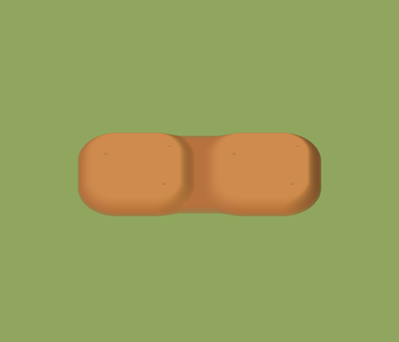
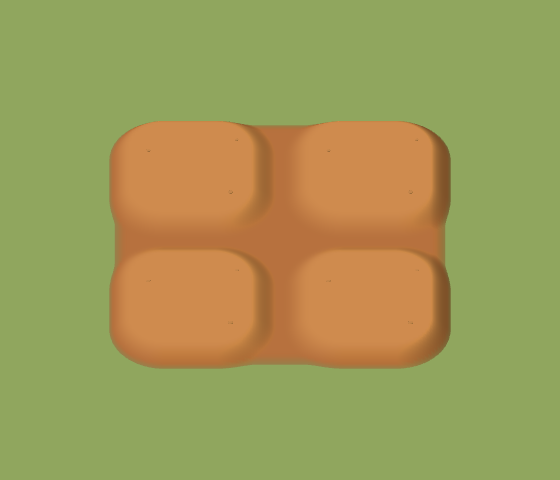
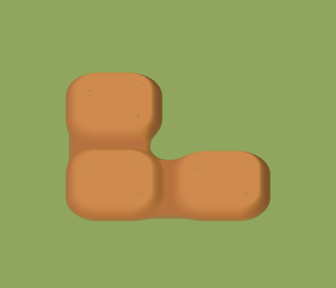

# 独立耕地、原尺寸作物与敌军查看

基于客户端 `0c91def`、设计仓库 `69e4448` 修正，保留小地图和内存面板等已交付功能。

## 用户确认的行为

每格是一块低矮饱满的小土块，相邻时仍保留各自圆润的隆起轮廓。中间是浅浅的土沟，沟底及四格交点由耕土覆盖。每格中央一颗胡萝卜或一丛小麦，幼苗、生长中和成熟三个阶段都恢复改四株之前的尺寸。

没有选中可攻击的我方士兵时，直接点击敌军查看其头顶血量条，并显示脚下红圈；不会出现底部单位卡。再次点击同一敌军、点击空地或切换对象取消查看，死亡和离场也会清除。血条取消常显后继续遵循原先生命变化短暂显示规则。选中我方士兵或含士兵的编队后点击敌军，继续使用原攻击指令和目标反馈。

非农民点农民作业目标时，只保留目标操作处的「此作业需要农民」，禁用相应作业按钮；取消作业、拆除保持可用。

## 修正原因

上一版将“内部不能露出草地”误解成整片土面抹平，清除了内部轮廓。本次将每格自己的圆肩高度与邻接土层高度组合：土块顶部仍为 0.187，内部浅沟底为 0.055，高于草地 0.012。外侧收边仍自然落入草地；新增和拆除只更新受影响的邻接模板，格子操作与结算保持独立。使用既有 Babylon Ground 网格、法线和实例缓存，未叠加额外地板或渲染通道。

四株来自 `e1796d4` 的田字型改动，复制模型同时额外乘了 0.62。现在去掉复制与缩小，直接使用未改动的原始 `createCropModel`：阶段系数为 0.35／0.65／1，只抬高根部 0.09 适配新土面。浏览器比较实际合并后实例的顶点数量、顶点坐标范围与居中位置，覆盖两种作物的三个阶段及实际新播种的幼苗；不使用旋转前包围盒代替实际顶点尺寸。

敌军点击以前总进入攻击分支，未选士兵时就提示先选士兵。现在无我方攻击者时进入独立查看状态，复用现有头顶生命条和一个 Babylon 原生圆环，红圈跟随渲染插值位置，不把敌军加入可指挥单位列表。重复作业提示来自目标卡片与失败浮层同时显示，现由目标卡片统一呈现，并在无资格时阻止自动作业调用。

## 验证与复现

直接相关的 20 项逻辑测试通过；类型检查和生产构建通过。

```sh
node --test --test-isolation=none tests/farm-model.test.ts tests/economy.test.ts \
  tests/commands.test.ts tests/health-indicator.test.ts tests/world-selection.test.ts
npm run build
```

启动本地 Vite 后，以下工具使用实际 Babylon 场景及 Chromium 原生鼠标、触控。工具内的场景读取和伤害测试入口仅注入测试页面，不进入产品代码。

```sh
npm run dev -- --port 5176 --strictPort
MAP_FARM_REVIEW_CASES=model MAP_FARM_REVIEW_DIR=/tmp/world-farm-beds node tools/review-map-farm.mjs
node tools/review-farm-beds.mjs
node tools/review-enemy-inspection.mjs
```

几何检查覆盖横向／纵向连接、L 形、四格交点的高度、法线、颜色连续性，以及原生射线不会穿过沟底。作物的数量和三个阶段原始尺寸见[尺寸记录](crop-sizes.json)。

浏览器验证通过：六种原尺寸作物状态、实际新播种幼苗、收获、拆除及保存重载；敌方步兵、弓兵、骑兵和灰狼的头顶血条与红圈、重复点击取消、鼠标与触控、受伤数值更新、死亡清除、原单兵攻击指令，以及非农民作业只出现一条提示。详见[耕地浏览器结果](browser-results.json)和[敌军交互结果](inspection-results.json)。

| 两格 | 四格 | L 形 |
| --- | --- | --- |
|  |  |  |

[手机作物阶段](crops-mobile.png) · [桌面作物阶段](crops-desktop.png) · [实际播种幼苗](sown-seedling.png)

[敌军头顶血条](inspect-infantry.png) · [敌方骑兵](inspect-cavalry.png) · [攻击指令](attack-command.png) · [唯一作业提示](farmer-hint.png)

[拆除后外沿](removed.png) · [重载后](reloaded.png) · [俯视接缝](soil-block-top.png) · [单块侧面](soil-single-side.png)

## 后续修正：地块铺满格子、收窄浅沟

用户指出四边留白仍太宽，现将圆肩推近格边：直边处两块之间的沟及两侧坡面总宽从约 0.57 收至 0.216 世界单位，每格仍占 1.69×1.69。四边接近边缘的位置仍为隆起土面，保留独立圆角和浅沟，顶部、沟底及作物高度与尺寸沿用本批已确认值。仅调整原网格的高度曲线与圆角影响范围，不增加网格、材质或每帧计算。

两项耕地几何测试通过，包含窄边距、连接高度／法线／颜色、四格交点无洞及拆除还原；类型检查和生产构建通过。Chromium 原生 Babylon 场景检查单块、两格、四格、L 形，以及 393×852 手机视口的实际田地；地块点击仍定位正确，播种按钮可用，浏览器无错误。

```sh
node --test --test-isolation=none tests/farm-model.test.ts
npm run build
MAP_FARM_REVIEW_CASES=model,appearance MAP_FARM_REVIEW_DIR=/tmp/world-farm-tight-beds node tools/review-map-farm.mjs
```

最新外观：[四格窄沟](beds-wide-block.png) · [手机实际田地](beds-wide-mobile.png) · [独立点选](beds-wide-selected.png) · [浏览器结果](beds-wide-results.json)。上文早先图片保留为本批修正前的记录。
