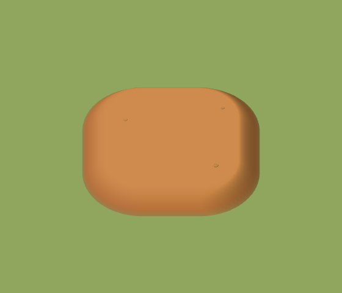
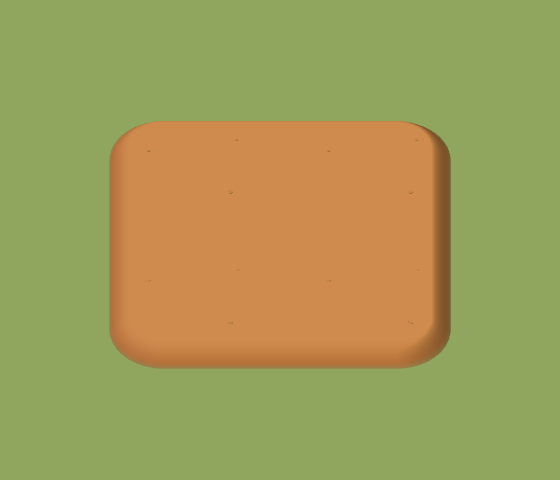
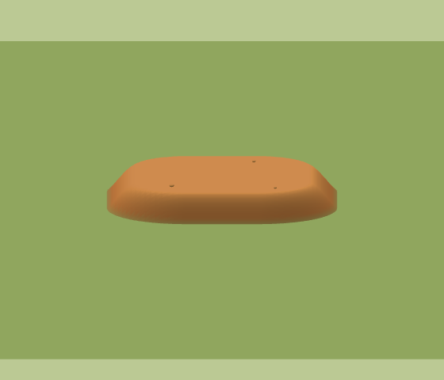

# 小地图、性能信息与单块耕土

基于 world-client `4b538f8`、world-design `204a46b` 完成本批修改。

后续用户已澄清耕地须保留每格隆起和土色浅沟，并恢复每格单株及原始尺寸。本记录保留当时交付过程，耕地最终行为以[修正记录](../farm-beds-enemy-inspection/implementation.md)为准。

## 最终行为

- 右上角增加地图按钮，放在设置左边，大小与设置一致。默认折叠，展开时北方朝上，显示实际地形、道路、水域、建筑、耕地与存活单位，选中单位加亮，浅框表示当前镜头的真实地面视野。展开／折叠不暂停，不下达人物指令；设置仍按原规则暂停并阻止下层输入。
- FPS、CPU、三角面数移到资源栏下方，JS 内存加入同一个紧凑面板，作业入口和事件提示依次下排。320、393、844、1280 CSS 像素宽度的界面已检查，右上按钮、小地图、性能信息及作业入口互不遮挡。
- JS 内存读取浏览器的 `performance.memory.usedJSHeapSize`，按 MB（1e6 字节）显示。统计范围明确为 JS 堆，不把它冒充 GPU、贴图或整个页面的总内存。无法读取或值无效时显示「—」，日志记 null；数值随原半秒性能采样刷新，暂停保留最后样本。
- 耕土依据最后确认的单块原型制作，低矮饱满、暖棕哑光、外缘圆润。用户追加的相邻地块规则也已实现：整片耕土连续，内部无草缝；新增／开垦／拆除自动重建受影响的邻接形状，仍逐格点选、作业和保存。作物、选中区域与落地物品高度适配土面。

## 原因与实现

旧田字造型由四个方床、凸起十字和底板组合，不能呈现用户最终指定的完整土面。初版单块在每格都缩边、倒圆角，导致连建时露出草缝。最终改为从八邻域中找真正的外边界，合并共线外沿，仅对整片外围做柔和收边；内部边界和四格交点的高度、法线与颜色一致。普通格子逻辑、寻路占地和生产结算不合并。

耕土使用 Babylon 原生 `MeshBuilder.CreateGround` 与共享材质，网格采样集中在曲肩；每种邻接状态只生成一次模板，各地块继续使用原生实例。原型及更新后的设计见[单块耕土规范](https://github.com/goodleap/world-design/blob/main/玩法设计/基础经营/种植采集与建设.md)。实际渲染检查了单块、横向连接、四格连接、L 形，以及俯视、侧面和手机缩小效果。

小地图是二维简图，使用成熟的 Canvas 2D API 和同一套世界数据，底图首次展开才生成，动态标记最多 5 Hz 更新；折叠不绘制，重开复用缓存。地面视野通过 Babylon 原生相机射线计算。没有新增 3D 相机、渲染通道或独立循环。两张 320×320 RGBA 位图约 0.82 MB，不是整个功能的实测内存总量。

## 验证

类型检查与 Vite 生产构建通过。22 项直接相关逻辑测试通过；最终曲面细分调整后另复验了同一组 2 项地块几何检查，接缝、法线、颜色与原生射线仍通过，不重复计入总数。

```sh
npm run build
node --test --test-isolation=none \
  tests/farm-model.test.ts tests/economy.test.ts tests/construction.test.ts \
  tests/heap-memory.test.ts tests/performance-log.test.ts tests/performance-clock.test.ts
```

浏览器使用真实 Babylon 场景和原生鼠标／触控。验证折叠后绘制次数停止、重开底图只生成一次、相机移动后视野框同步、面板点击不改变单位命令、设置暂停不推进时钟／内存样本、正常支持和缺失内存 API 两种情况。农民实际收获后，拆除一块耕地，再保存并重新加载，地块和产出状态正确，缺口与外沿恢复正确。结果见 [浏览器记录](browser-results.json)。

复现：启动 `npm run dev -- --port 5176 --strictPort`，运行 `MAP_FARM_REVIEW_CASES=model,mobile,desktop,appearance node tools/review-map-farm.mjs`。需 Node 24、系统 Chromium、现有 Playwright。输出默认在 `/tmp/world-map-farm`，地址、输出位置、场景和浏览器路径可通过工具中的环境变量调整。

## 实际渲染

| 单块耕土 | 相邻四格 | 侧面 |
| --- | --- | --- |
|  |  |  |

[最终游戏画面](farms-final.png) · [单格选中](farm-selected.png) · [拆除后](farm-removed.png) · [重载后](farm-reloaded.png)

[320 窄屏](mobile-320.png) · [393 竖屏](mobile-393.png) · [844 横屏](mobile-844.png) · [桌面与内存缺失](desktop-1280.png)
